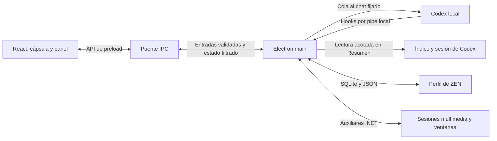

# Arquitectura de ZEN

## 01 · Sistema activo 

ZEN es un compañero local de Codex para Windows. Una sola ventana Electron muestra el estado en una cápsula y abre Inicio, Codex, Sonido, HUB, Calendario y Ajustes en el panel. Codex conserva la cuenta, los chats y la ejecución. Windows publica las sesiones multimedia. ZEN gestiona la interfaz, las preferencias y la biblioteca local.

Main notifica los cambios de superficie aceptados con un evento semántico. El renderer prepara un `AudioContext` compartido en inactividad y sintetiza cada tono local al primer uso. Los efectos se sustituyen o descartan según el intervalo, y el dispositivo se libera durante la inactividad. Esta salida es independiente de las sesiones multimedia de Windows. [Audio de interfaz](../src/renderer/companion-interface-audio.ts)

El proceso principal se compila con esbuild. El renderer usa React, TypeScript y Vite. El puente usa Zod para validar entradas y el almacenamiento local usa `node:sqlite`. Los auxiliares son proyectos .NET 10. Las versiones se fijan en [package.json](../package.json) y [package-lock.json](../package-lock.json).

## 02 · Límites y responsabilidades 

| Límite | Responsabilidad | Fuente |
| --- | --- | --- |
| Renderer | Vistas, navegación, editores y representación del estado. | [Entrada React](../src/renderer/main.tsx) |
| Preload | Expone métodos explícitos de `window.companion` y suscripción al estado. | [Puente](../src/preload/companion.ts) |
| Main | Ventana, bandeja, atajos, estado, visibilidad, diálogos y efectos autorizados. | [Entrada Electron](../src/main/companion-main.ts) · [IPC](../src/main/companion-ipc.ts) |
| Contratos | Esquemas, tipos y reglas de presentación compartidos. | [Contrato del compañero](../src/shared/codex-companion.ts) |
| Auxiliares Windows | El hook transmite eventos, el auxiliar de escritorio observa ventanas y el de medios usa las sesiones de Windows. La compilación también incluye `Zen.Windows`. | [Manifiesto de auxiliares](../config/native-helpers.json) |
| Construcción y pruebas | Bundles, empaquetado portable y recorridos con perfiles de prueba. | [Despliegue](DEPLOYMENT.md) · [Pruebas](TESTING.md) |

## 03 · Flujo de datos 

1. **Petición.** Main comprueba la vista y el destino. Con chat fijado, el CLI ejecuta `queue --thread`. Tras validar el recibo, ZEN solicita a Codex de escritorio que reactive ese mismo chat mediante `codex://threads/wake/<id>`. El enlace contiene solo el identificador. Sin destino, se prepara un borrador en Codex o se copia el texto cuando el enlace supera el límite. El turno se observa por separado.
2. **Actividad y respuesta.** El puente recoge eventos de Codex. Actividad supervisa los chats observados y permite abrir el chat seleccionado. Main envía esa lista únicamente con Actividad visible y recupera los títulos ausentes del índice local de solo lectura. El chat fijado define las respuestas de Resumen, los permisos interactivos y las notificaciones. Analizar agrega una revisión de un uso y una referencia para correlacionar el resultado.
3. **Sonido.** Un observador lee automáticamente la sesión en reproducción o en pausa que publica Windows. Un controlador separado actúa sobre la sesión seleccionada con un gesto explícito desde Sonido. Al ocultar el panel se detienen sus consultas periódicas y se conserva la selección. Ocultar no envía órdenes al reproductor.
4. **HUB.** La biblioteca se lee y escribe en el perfil local. Inicio recibe hasta cuatro apuntes recientes con metadatos de navegación. El [IPC del HUB](../src/main/companion-notes-ipc.ts) gestiona la vista y sus archivos. El [IPC de respaldo](../src/main/companion-backup-ipc.ts) gestiona desde Preferencias la copia portable de la biblioteca y de los ajustes.

Templates usa registros separados en el mismo SQLite. La lista devuelve metadatos ligeros y el detalle carga el prompt completo cuando se abre. Las referencias se guardan con su original y una miniatura, y se sirven bajo demanda por el protocolo local mientras HUB está visible. Una marca de inicialización evita reinsertar ejemplos borrados. El respaldo incluye ambos tipos de registros y sus borradores en la copia completa. [Almacenamiento de Templates](../src/main/knowledge-templates.ts)

## 04 · Persistencia y decisiones 

| Datos | Almacenamiento y propiedad |
| --- | --- |
| Apuntes, prompts y borradores | `knowledge-hub.sqlite` en el perfil ZEN. [HUB](../src/main/knowledge-hub.ts) contempla la biblioteca anterior en JSON. |
| Preferencias y aspecto | JSON local y fondo normalizado. La posición se guarda por monitor. El respaldo portable reúne solo los datos descritos en [Despliegue](DEPLOYMENT.md). |
| Última respuesta | Índice SQLite y sesión JSONL de Codex, de solo lectura para ZEN. |
| Actividad, avisos y revisiones | Estado acotado de la sesión en memoria. |

La autoridad sobre los efectos queda en main. Una ventana contiene una cápsula pequeña y un panel opcional. Las operaciones de navegación convergen en abrir, cambiar u ocultar el panel. Los comandos antiguos de presentación se adaptan a estas operaciones. Los estados guardados de cápsula y Workspace conservan su presentación y añaden la sección visible.

La geometría de [cápsula y panel](../src/main/companion-capsule-layout.ts) calcula sus rectángulos y la unión de sus regiones interactivas. La cápsula conserva su tamaño. El panel aprovecha el espacio interior y el redimensionado nativo. El fondo de las zonas excluidas deja pasar clics. El candado controla el arrastre y la apertura por cursor en Windows. Siempre encima conserva su propia preferencia.

En el renderer, `workspace-surface` contiene la escena y su capa de cristal, y `workspace-content` conserva el scroll y el foco. El movimiento se aplica al contenido mientras la escena, el cristal y el contorno mantienen su opacidad. Las vistas comparten el fondo. El tema específico de HUB queda limitado al lector, con la misma preferencia persistida.

En Windows, `companion-hover` mide la permanencia en cada icono de Apps y el tiempo fuera de la región que comparten la cápsula y el panel. El renderer identifica el icono y comunica las interacciones que aplazan el temporizador. Main valida la sección, la posición del cursor y el candado antes de actuar mediante la navegación existente. Las dos presentaciones comparten el área de dibujo de la ventana. El recorte deja visible la cápsula hasta que el compositor prepara el panel. Al hacer clic se activa la ventana y se habilitan sus controles nativos.

Main abre gradualmente la región nativa desde la cápsula cuando el panel ya está dibujado. En el repliegue automático, la región se reduce hacia el mismo borde. La superficie de dibujo permanece fija y el escritorio queda accesible en la parte descubierta. El área original sigue contando para detectar el regreso del cursor y revertir el repliegue.

Al cambiar desde Apps con el panel abierto, el renderer usa el orden de los iconos visibles para decidir el sentido del giro. Una transición acotada al elemento de contenido usa las capturas saliente y entrante como caras del cubo. La sección sigue usando su árbol React y su estado habituales. Si llega otro destino, se prioriza esa selección.

La X minimiza la ventana de ZEN y la conserva en la barra de tareas. Al restaurar vuelven la misma vista y el borrador de Inicio mantenido en memoria. Al minimizar, main sigue revocando el contexto de revisión y los accesos que requieren una vista visible. **Salir de ZEN** ejecuta el cierre de Electron y libera el bloqueo de instancia.

Codex ejecuta las consultas de Gmail y Calendar mediante las conexiones configuradas allí. El arranque activo usa el compañero de Codex y el repositorio conserva implementaciones históricas fuera de ese flujo.

## 05 · Dependencias y límites 

El envío directo depende de `queue` en el CLI y de la reactivación de la cola en Codex de escritorio. La lectura del último mensaje depende del formato local de Codex. El reproductor solo puede mostrar y controlar lo que exponga Windows. Ante una entrega incierta o un fallo de reactivación, revisa la cola del chat antes de reenviar. Los límites de acceso se detallan en [Seguridad](SECURITY.md).

## 06 · Calendario

[Calendario](../src/main/companion-calendar.ts) conserva eventos locales y una copia validada de los resultados remotos en `companion-calendar.json`. Su IPC exige Calendario visible, sin Pausa ni Presentación. Las peticiones usan exclusivamente la cola de Codex del chat fijado. Las respuestas llegan por el hook o por el lector existente mientras hay una solicitud pendiente.

El contrato `zen_calendar` liga respuesta, cuenta, calendario, intervalo y solicitud. La cobertura completa permite conciliar ausencias dentro del intervalo. Los resultados parciales se fusionan y una consulta selectiva conserva la cobertura de los otros calendarios. Las creaciones externas conservan un recibo local para evitar repetir una operación incierta después de reiniciar. Elegir explícitamente **Solo en ZEN** permite guardar una copia local mientras sigue pendiente la confirmación externa. El respaldo portable incluye los eventos locales.
