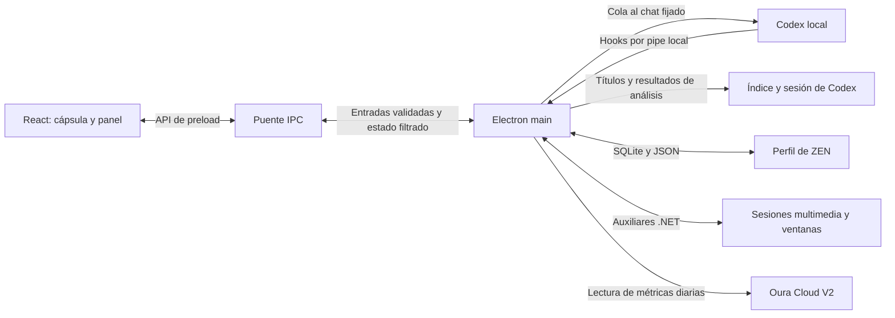

# Arquitectura de ZEN

[Diagramas de arquitectura y Officina](diagrams/index.html)

**Contraseñas en HUB.** `PasswordVault` guarda una base KeePass KDBX 4 independiente en `passwords.kdbx`, con AES-256, autenticación KDBX y Argon2id (64 MiB, tres iteraciones). `kdbxweb` y `hash-wasm` se empaquetan en main; el renderer recibe metadatos solo con la bóveda desbloqueada y una contraseña únicamente al pulsar el ojo. Las escrituras usan archivo temporal cifrado, flush y sustitución atómica. Bloquear revoca también las operaciones asíncronas pendientes. El auxiliar `Zen.VaultClipboard` recibe la copia por stdin y conserva su temporizador de 30 segundos separado de la ventana. Antes del repliegue nativo se espera un frame sin valores revelados. [Formato KDBX](https://keepass.info/help/kb/kdbx.html).

`Zen.VaultHello` usa el proveedor Microsoft Passport de CNG para las nuevas activaciones y conserva WebAuthn PRF para abrir o revocar configuraciones anteriores. Devuelve a main la clave simétrica una vez verificada la identidad. `VaultHelloBinding` cifra y autentica el componente de contraseña del KDBX en el archivo local de Windows Hello. El proceso nativo usa el HWND de ZEN como propietario del diálogo. El IPC reutiliza la sesión de Contraseñas y la protección de diálogos de la cápsula.

## 01 · Sistema activo 

ZEN es un compañero local de Codex para Windows. Una sola ventana Electron muestra el estado en una cápsula y abre Home, HUB, Calendario, Métricas, Volumen y Configuración en el panel. HUB incluye Contraseñas y Home también abre Codex. Codex conserva la cuenta, los chats y la ejecución. Windows publica las sesiones multimedia. ZEN gestiona la interfaz, las preferencias y la biblioteca local.

Main notifica los cambios de superficie aceptados con un evento semántico. El renderer prepara un `AudioContext` compartido en inactividad y sintetiza cada tono local al primer uso. Los efectos se sustituyen o descartan según el intervalo, y el dispositivo se libera durante la inactividad. Esta salida es independiente de las sesiones multimedia de Windows. [Audio de interfaz](../src/renderer/companion-interface-audio.ts)

El proceso principal se compila con esbuild. El renderer usa React, TypeScript y Vite. El puente usa Zod para validar entradas y el almacenamiento local usa `node:sqlite`. Los auxiliares son proyectos .NET 10. Las versiones se fijan en [package.json](../package.json) y [package-lock.json](../package-lock.json).

## 02 · Límites y responsabilidades 

| Límite | Responsabilidad | Fuente |
| --- | --- | --- |
| Renderer | Vistas, navegación, editores y representación del estado. | [Entrada React](../src/renderer/main.tsx) |
| Preload | Expone métodos explícitos de `window.companion` y suscripción al estado. | [Puente](../src/preload/companion.ts) |
| Main | Ventana, bandeja, atajos, estado, visibilidad, diálogos y efectos autorizados. | [Entrada Electron](../src/main/companion-main.ts) · [IPC](../src/main/companion-ipc.ts) |
| Contratos | Esquemas, tipos y reglas de presentación compartidos. | [Contrato del compañero](../src/shared/codex-companion.ts) |
| Auxiliares Windows | El hook transmite eventos, el auxiliar de escritorio observa ventanas y el de medios usa las sesiones de Windows. La compilación también incluye `Zen.Windows`. | [Manifiesto de auxiliares](../config/native-helpers.json) |
| Construcción y pruebas | Bundles, empaquetado portable y recorridos con perfiles de prueba. | [Despliegue](DEPLOYMENT.md) · [Pruebas](TESTING.md) |

## 03 · Flujo de datos 

1. **Petición.** Main comprueba la vista y el destino. Con chat fijado, el CLI ejecuta `queue --thread`. Tras validar el recibo, ZEN solicita a Codex de escritorio que reactive ese mismo chat mediante `codex://threads/wake/<id>`. El enlace contiene solo el identificador. Sin destino, se prepara un borrador en Codex o se copia el texto cuando el enlace supera el límite. El turno se observa por separado.
2. **Actividad de Codex.** Main envía la cronología del supervisor con Actividad visible y recupera los títulos del índice local de solo lectura. La cronología de otros chats muestra nombres de comandos reconocidos. La tarjeta de Permisos recibe los comandos completos que Main correlaciona con el inicio del turno y su carpeta. El hook espera una decisión de un uso. **Abrir en Codex** libera la espera sin decidir y abre el chat exacto. El análisis del chat fijado conserva su referencia de correlación.
3. **Sonido.** Un observador lee automáticamente la sesión en reproducción o en pausa que publica Windows. Un controlador separado actúa sobre la sesión seleccionada con un gesto explícito desde Sonido. Otro canal del mismo auxiliar usa Core Audio para consultar y ajustar el volumen de la salida predeterminada, incluso sin una sesión multimedia. Al ocultar el panel se detienen las consultas y se conserva la selección. Ocultar no envía órdenes al reproductor.
4. **HUB.** La biblioteca se lee y escribe en el perfil local. Desde Home se accede al HUB con su píldora. El [IPC del HUB](../src/main/companion-notes-ipc.ts) gestiona la vista y sus archivos. El [IPC de respaldo](../src/main/companion-backup-ipc.ts) gestiona desde Preferencias la copia portable de la biblioteca y de los ajustes.

**Apuntes rápidos.** La hoja guarda su texto, selección y scroll en una fila de `hub_state` dentro de `knowledge-hub.sqlite`. Su IPC valida el origen y la vista activa y confirma la transacción local antes de devolver el control al editor. La fila queda fuera del índice, de los apuntes recientes y de los respaldos de la biblioteca, y se conserva al restaurarlos.

**Pizarra.** El SQLite de HUB conserva una sola hoja con el color, el grosor y las operaciones de pincel y goma. Las coordenadas parten de la hoja original de 960 × 640 y se extienden con el área disponible. Las operaciones nuevas guardan los límites visibles al dibujar y las anteriores conservan los de la hoja original. Main valida el documento antes de guardarlo. El renderer repinta las operaciones en orden con la paleta activa y una escala uniforme. Deshacer elimina la última operación. Cada gesto terminado se guarda en una transacción local.

Templates usa registros separados en el mismo SQLite. La lista devuelve metadatos ligeros y el detalle carga los prompts de las plataformas disponibles cuando se abre. Las referencias se guardan con su original y una miniatura, y se sirven bajo demanda por el protocolo local mientras HUB está visible. La versión de la colección permite sustituir una sola vez los ejemplos editoriales por los empresariales. La ampliación agrega las 23 fichas nuevas una sola vez y conserva las ediciones, favoritos y borradores. La marca de versión evita reinsertar ejemplos borrados. La migración reconoce los identificadores originales y conserva las plantillas personales. El respaldo incluye ambos tipos de registros y sus borradores en la copia completa. [Almacenamiento de Templates](../src/main/knowledge-templates.ts)

**Descubrimiento de apps** guarda fichas bilingües en el SQLite de HUB y las incluye en el respaldo. El renderer construye la propuesta inicial con reglas locales y prepara una petición separada del borrador normal de Inicio. El envío pasa por el mismo IPC y la misma comprobación de destino que las demás peticiones de Inicio.

**Officina** usa el selector y la geometría de la cápsula. Main conserva cada tablero, objetivo y cola en `officina.sqlite`. El Chat global crea un proyecto con `project/create` y registra los cinco chats de puesto y Coordinación con `thread/start`. Usa una clave de creación estable, guarda cada confirmación y puede continuar una preparación parcial. Si al despachar falta un chat dedicado, comprueba el índice y el App Server antes de reemplazar la referencia de ese puesto. Los vínculos manuales anteriores siguen disponibles. El botón **Abrir carpeta en Codex** apunta a la raíz guardada del proyecto mediante el enlace de escritorio. La barra lateral de Codex gestiona su propia lista de carpetas.

Coordinación define los pasos de sus objetivos. Cada chat recibe el paso asignado y la evidencia de ese encargo. Officina toma por orden los turnos habilitados del proyecto visible y mantiene un envío activo a la vez. Una decisión pendiente de Officina suspende su objetivo y permite despachar otros. La respuesta humana, su referencia al turno original y la continuación se guardan en la misma escritura del tablero. La recuperación de una respuesta comprobada reanuda el paso original, incluido el caso de decisiones de Arquitectura ya registradas con el plan pausado.

El puente pone cada turno en cola. La insignia del maletín se actualiza con un ciclo independiente que lee el tablero y los turnos locales en modo de solo lectura. La suscripción de estado entrega a la cápsula únicamente la señal y el recuento. Los destinos se muestran en Officina y Main los vuelve a verificar al seleccionarlos. Cuando el usuario pide su navegador habitual, el turno del puesto incluye la mención de la extensión. Una revisión clara de pestañas abiertas se asigna directamente al Analista. Coordinación planifica los demás objetivos y verifica los resultados. El lector local comprueba la respuesta final, la carpeta, la ejecución, la tarea y el puesto. Main guarda juntos los resultados y las nuevas asignaciones. El tablero recuerda si la cola estaba activa o pausada y la retoma en el proyecto visible. Ante un fallo anterior a la entrega, Main programa un número acotado de reintentos. Tras un envío incierto, busca la identidad original en el turno y en la cola del chat verificado. Puede avisar a Codex si encuentra el encargo existente. [Servicio de Officina](../src/main/companion-officina.ts) La construcción del encargo y la validación de la respuesta viven en el [módulo de turnos](../src/main/companion-officina-turn.ts). El [compositor](../src/renderer/OfficinaComposer.tsx) mantiene el borrador y envía las acciones del chat a través de la vista de Officina.

Para mostrar un trabajo en curso, Main verifica en el registro local el mensaje aceptado del turno con la identidad completa del encargo. Después conserva esa identidad en memoria y lee las líneas completas añadidas para identificar el cierre, la interrupción o un nuevo turno. Así el estado sigue vinculado al mismo turno cuando crece el registro. Si el circuito de permisos indica una solicitud del mismo chat, carpeta y turno, Officina muestra la espera de permiso. El tablero enlaza las aportaciones de los especialistas con su ejecución mediante el evento y las de Coordinación mediante el historial y el tipo de respuesta. La lectura de resultados usa esos registros locales. Main vuelve a comprobar el proyecto visible al recibir un envío a un puesto y usa la conversación registrada en la ejecución al abrir un resultado en Codex.

Main puede recuperar la respuesta de un turno concreto aunque se hayan abierto otros turnos en el mismo chat. La actividad directa de los chats vinculados se consulta por separado. Main verifica el chat y su carpeta y entrega al panel solo el estado y la hora.

Los perfiles de Officina tienen un nombre visible y un prompt por puesto y proyecto. Los tableros anteriores y los puestos sin perfil personalizado usan los valores de desarrollo de aplicaciones. Main incorpora el perfil vigente como contexto de cada nuevo turno y conserva los identificadores que vinculan chats, ejecuciones y resultados.

Main guarda las capturas de los encargos en `officina-images/`, dentro del perfil de ZEN. El objetivo conserva las referencias y las huellas. El puente usa `localImage` en la cola estructurada de Codex y comprueba la correlación con el turno antes de abrir la conversación de destino.

ZEN es un observador disponible en cada proyecto. Al solicitar una revisión, Main prepara un chat de solo lectura para ZEN y una muestra acotada del historial de Officina con los perfiles que se revisan. La revisión tiene su propia identidad y comparte el transporte de Codex. Se guarda fuera de los flujos de asignación, traspaso y cierre de tareas. Main comprueba el proyecto visible y las instrucciones revisadas antes de aplicar un prompt por decisión del usuario. La aprobación de una recomendación guarda un seguimiento propio en la cola de ZEN. La respuesta del seguimiento se registra en la ejecución vinculada a esa propuesta y conserva el estado de la entrega original. [Observador de Officina](../src/main/companion-officina-observer.ts)

Main también registra una propuesta local de ZEN cuando un turno terminado y correlacionado devuelve una respuesta incompatible o cuando un puesto documenta una limitación ligada a un traspaso. Una respuesta incompatible queda en **Requiere revisión** con acceso al chat. La limitación vinculada conserva la referencia a su entrega y el QA permanece pendiente. La detección local reutiliza las revisiones de ZEN para la decisión manual. Si una decisión de Arquitecto queda en revisión por el formato anterior o por exceder el límite de Markdown, Main recupera el turno exacto, exige la identidad del encargo y abrevia el Markdown que supere el límite local. El chat conserva el informe íntegro.

Con **Mejoras automáticas** activadas en un proyecto vinculado, Main convierte las incidencias confirmadas en encargos de Coordinación con un identificador de origen. El encargo y el ajuste se guardan juntos en el tablero. La cola existente despacha sus turnos cuando el proyecto está visible y conserva la correlación tras reiniciar. El flujo exige Desarrollo, Tester y ALM en ese orden. Para enviar a ALM, Main comprueba el traspaso y el QA de Codex de la misma ronda. Las incidencias de la propia mejora quedan para revisión humana.

Los textos pegados se guardan en el objetivo local. Antes de enviar un turno, Main prepara un Markdown por tarea en `officina-pastes` dentro del perfil de ZEN y pasa su ruta a Codex. Coordinación y los especialistas leen el mismo documento aunque el contenido supere el límite del puente.

Si el historial y las dependencias superan el límite del puente, Main conserva el encargo breve y prepara la evidencia completa del turno en `officina-turns` dentro del perfil local. Un cierre que quedó pendiente antes del envío puede reusar su ejecución desde la ficha. Si Desarrollo entrega una versión y el siguiente paso del plan es Tester, un solo turno lleva la instrucción del plan y la referencia de la entrega.

Las respuestas de equipo y Coordinación pueden incluir un resumen para el seguimiento y un cuerpo Markdown para el usuario. Main guarda ambos y mantiene acotado el contexto que envía al siguiente turno. Una respuesta ya registrada en Codex con el texto completo en el campo anterior se puede recuperar al volver a revisar la cola.

Al elegir una carpeta, Main la usa como raíz del proyecto de Codex, `cwd` y raíz de ejecución de los chats del equipo. Una carpeta que ya tiene proyecto se reutiliza. Los archivos seleccionados se guardan como referencias del encargo y pasan a los turnos de su equipo en el contexto de la petición. Codex lee las fuentes con sus herramientas locales. Main comprueba la identidad de las rutas antes de crear el equipo y antes del envío.

Una conclusión cierra el objetivo y omite los turnos que todavía estaban en cola para esa tarea. Cuando el último turno guardado de un objetivo antiguo terminó con una limitación confirmada y ya no tiene trabajo en curso ni en cola, la lectura lo proyecta como cerrado con limitaciones. La siguiente escritura normal guarda el estado de cierre y mantiene el registro original del turno y de su respuesta.

**Métricas.** Main abre la autorización de Oura en el navegador del sistema y recibe el retorno de un solo uso en loopback. Si el retorno válido no enumera `daily`, Main comprueba el acceso al recurso de sueño diario con Oura Cloud antes de guardar la sesión. Guarda las series diarias y sus horas de consulta. El panel de Métricas recibe las series mientras está visible. Home recibe solo la última medición de sueño de la caché. La cápsula recibe la duración y el día del último sueño si se eligió esa opción.

**Clima.** Main consulta las condiciones actuales y la previsión de tres horas de OpenWeather con la clave cifrada de cada instalación. Agrupa los tramos por fecha local de la ciudad y conserva la última previsión en almacenamiento cifrado. Home intenta actualizar al abrirse, al recuperar la conexión y al reanudar el equipo, con un intervalo de quince minutos en condiciones normales. [Cliente OpenWeather](../src/main/openweather-api.ts)

**Resumen diario.** [Main](../src/main/companion-daily-home.ts) reúne pronóstico vigente y observaciones del calendario local y sincronizado. El resumen consulta observaciones externas de hasta 24 horas; las recurrencias se expanden en la sincronización de Calendario. Guarda el mensaje, zona, fecha, generación, origen local y huella del contexto. El saludo horario se calcula al mostrarlo. El puerto de ampliación es `DailyContext`: cada fuente nueva debe aportar los datos mínimos, su origen, fecha y vigencia. El compañero empaquetado solo envía peticiones al chat fijado. El runtime de chats de la aplicación histórica permite herramientas y revisiones. Falta un flujo integrado que ejecute un turno aislado sin herramientas y valide su respuesta antes de usarla en Home.

**Traductor.** [El cliente de Azure en main](../src/main/companion-translator.ts) usa el endpoint Global de traducción de texto v3 y conserva la clave cifrada en `companion-translator.bin`. El IPC admite español e inglés y limita cada texto a 5000 caracteres. El panel de HUB mantiene el texto y el resultado durante la visita a Traductor.

## 04 · Persistencia y decisiones 

| Datos | Almacenamiento y propiedad |
| --- | --- |
| Apuntes, prompts y borradores | `knowledge-hub.sqlite` en el perfil ZEN. [HUB](../src/main/knowledge-hub.ts) contempla la biblioteca anterior en JSON. |
| Preferencias y aspecto | JSON local y fondo normalizado. La posición se guarda por monitor. El respaldo portable reúne solo los datos descritos en [Despliegue](DEPLOYMENT.md). |
| Última respuesta | Índice SQLite y sesión JSONL de Codex, de solo lectura para ZEN. |
| Actividad, avisos y revisiones | Estado acotado de la sesión en memoria. |
| Oura | Client ID, sesión y caché en `companion-oura.bin`, cifrados con el almacén de Windows. El Client ID se guarda al iniciar la autorización. |

**Perfil entre equipos.** Main reutiliza el formato portable para extraer datos guardados y aplica los cambios con recuperación local. Cada equipo escribe su propio archivo cifrado en una carpeta de Syncthing. Las revisiones por objeto conservan el contexto de la última versión aplicada para distinguir cambios sucesivos de ediciones simultáneas. Solo se aplican al perfil local los grupos que cambiaron. La bóveda tiene un flujo separado de copias KDBX cifradas que se combinan al desbloquear.

La autoridad sobre los efectos queda en main. Una ventana contiene una cápsula pequeña y un panel opcional. Las operaciones de navegación convergen en abrir, cambiar u ocultar el panel. Los comandos antiguos de presentación se adaptan a estas operaciones. Los estados guardados de cápsula y Workspace conservan su presentación y añaden la sección visible.

La geometría de [cápsula y panel](../src/main/companion-capsule-layout.ts) calcula sus rectángulos y la unión de sus regiones interactivas. La cápsula conserva su tamaño. El panel aprovecha el espacio interior y el redimensionado nativo. El fondo de las zonas excluidas deja pasar clics. El candado controla el arrastre y la apertura por cursor en Windows. Siempre encima conserva su propia preferencia.

Cuando llega una solicitud, Main abre Permisos en la misma ventana con prioridad temporal, conservando el foco anterior. Al resolver, cerrar o cambiar de sección, Main devuelve la prioridad a la preferencia guardada. La apertura automática se aplaza durante los diálogos y arrastres de ZEN.

En el renderer, `workspace-surface` contiene la escena y su capa de cristal, y `workspace-content` conserva el scroll y el foco. El movimiento se aplica al contenido mientras la escena, el cristal y el contorno mantienen su opacidad. Las vistas comparten el fondo. El tema específico de HUB queda limitado al lector, con la misma preferencia persistida.

En Windows, `companion-hover` mide la permanencia en cada icono de Apps y el tiempo fuera de la región que comparten la cápsula y el panel. El renderer identifica el icono y comunica las interacciones que aplazan el temporizador. Main valida la sección, la posición del cursor y el candado antes de actuar mediante la navegación existente. Las dos presentaciones comparten el área de dibujo de la ventana. El recorte deja visible la cápsula hasta que el compositor prepara el panel. Al hacer clic se activa la ventana y se habilitan sus controles nativos.

La [transición del panel](../src/main/companion-panel-transition.ts) coordina la espera de pintado, el progreso del recorte y su cancelación. Main aporta la captura de Electron y aplica la geometría nativa. Al abrir, la región se amplía desde la cápsula una vez dibujado el panel. Al replegar, se reduce hacia el mismo borde y el escritorio queda accesible en la parte descubierta. El área original sigue contando para detectar el regreso del cursor y revertir el repliegue.

El menú y las animaciones derivan el orden visible de la misma [regla de navegación](../src/shared/companion-navigation.ts). Con el panel abierto, el cambio desde Apps usa las capturas saliente y entrante como caras del cubo y conserva el estado de la sección. Si llega otro destino, se prioriza esa selección.

La X minimiza la ventana de ZEN y la conserva en la barra de tareas. Al restaurar vuelven la misma vista y el borrador de Inicio mantenido en memoria. Al minimizar, main sigue revocando el contexto de revisión y los accesos que requieren una vista visible. **Salir de ZEN** ejecuta el cierre de Electron y libera el bloqueo de instancia.

Codex ejecuta las consultas de Gmail y Calendar mediante las conexiones configuradas allí. El arranque activo usa el compañero de Codex y el repositorio conserva implementaciones históricas fuera de ese flujo.

## 05 · Dependencias y límites 

El envío directo depende de `queue` en el CLI y de la reactivación de la cola en Codex de escritorio. La lectura del último mensaje depende del formato local de Codex. El reproductor solo puede mostrar y controlar lo que exponga Windows. Ante una entrega incierta o un fallo de reactivación, revisa la cola del chat antes de reenviar. Los límites de acceso se detallan en [Seguridad](SECURITY.md).

## 06 · Calendario

[Calendario](../src/main/companion-calendar.ts) conserva eventos locales y una copia validada de los resultados remotos en `companion-calendar.json`. Su IPC exige Calendario visible, sin Pausa ni Presentación. Las peticiones usan exclusivamente la cola de Codex del chat fijado. Las respuestas llegan por el hook o por el lector existente mientras hay una solicitud pendiente.

El contrato `zen_calendar` liga respuesta, cuenta, calendario, intervalo y solicitud. La cobertura completa permite conciliar ausencias dentro del intervalo. Los resultados parciales se fusionan y una consulta selectiva conserva la cobertura de los otros calendarios. Las creaciones externas conservan un recibo local para evitar repetir una operación incierta después de reiniciar. Elegir explícitamente **Solo en ZEN** permite guardar una copia local mientras sigue pendiente la confirmación externa. El respaldo portable incluye los eventos locales.
