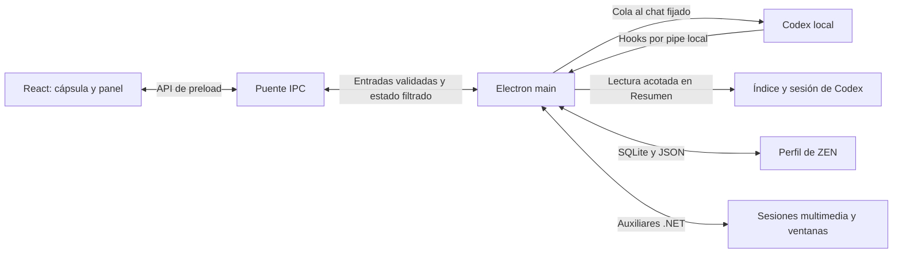

# Arquitectura de ZEN

## 01 · Sistema activo 

ZEN es un compañero local de Codex para Windows. Una sola ventana Electron muestra el estado en una cápsula y abre Inicio, Codex, Sonido y Apuntes en el panel desplegado. Codex conserva la cuenta, los chats y la ejecución. Windows publica las sesiones multimedia. ZEN gestiona la interfaz, las preferencias y la biblioteca local.

El proceso principal se compila con esbuild. El renderer usa React, TypeScript y Vite. El puente usa Zod para validar entradas y el almacenamiento local usa `node:sqlite`. Los auxiliares son proyectos .NET 10. Las versiones se fijan en [package.json](../package.json) y [package-lock.json](../package-lock.json).

## 02 · Límites y responsabilidades 

| Límite | Responsabilidad | Fuente |
| --- | --- | --- |
| Renderer | Vistas, navegación, editores y representación del estado. | [Entrada React](../src/renderer/main.tsx) |
| Preload | Expone métodos explícitos de `window.companion` y suscripción al estado. | [Puente](../src/preload/companion.ts) |
| Main | Ventana, bandeja, atajos, estado, visibilidad, diálogos y efectos autorizados. | [Entrada Electron](../src/main/companion-main.ts) · [IPC](../src/main/companion-ipc.ts) |
| Contratos | Esquemas, tipos y reglas de presentación compartidos. | [Contrato del compañero](../src/shared/codex-companion.ts) |
| Auxiliares Windows | El hook transmite eventos, el auxiliar de escritorio observa ventanas y el de medios usa las sesiones de Windows. La compilación también incluye `Zen.Windows`. | [Manifiesto de auxiliares](../config/native-helpers.json) |
| Construcción y pruebas | Bundles, empaquetado portable y recorridos con perfiles de prueba. | [Despliegue](DEPLOYMENT.md) · [Pruebas](TESTING.md) |

## 03 · Flujo de datos 

1. **Petición.** Main comprueba la vista y el destino. Con chat fijado, el CLI ejecuta `queue --thread` y ZEN valida que el recibo corresponda a ese chat. Sin destino, se prepara un borrador en Codex o se copia el texto cuando el enlace supera el límite. Un recibo acredita la cola. El turno se observa por separado.
2. **Actividad y respuesta.** El puente recoge eventos de Codex. Actividad muestra señales y Permisos gestiona decisiones pendientes. Resumen puede leer la última respuesta final del destino fijado. Analizar agrega una revisión de un uso y una referencia para correlacionar el resultado.
3. **Sonido.** Un observador lee automáticamente la sesión activa que publica Windows. Un controlador separado actúa sobre una sesión seleccionada y únicamente con un gesto explícito.
4. **Apuntes.** Knowledge Hub lee y escribe su propia biblioteca. Inicio recibe hasta cuatro apuntes recientes con metadatos de navegación. Los cuerpos, imágenes y borradores se abren en Apuntes.

## 04 · Persistencia y decisiones 

| Datos | Almacenamiento y propiedad |
| --- | --- |
| Apuntes, prompts y borradores | `knowledge-hub.sqlite` en el perfil ZEN. [Knowledge Hub](../src/main/knowledge-hub.ts) contempla la biblioteca anterior en JSON. |
| Preferencias y aspecto | JSON local y fondo normalizado. La posición se guarda por monitor. El respaldo portable reúne solo los datos descritos en [Despliegue](DEPLOYMENT.md). |
| Última respuesta | Índice SQLite y sesión JSONL de Codex, de solo lectura para ZEN. |
| Actividad, avisos y revisiones | Estado acotado de la sesión en memoria. |

La autoridad sobre los efectos queda en main. El panel se despliega en la misma ventana para conservar controles y anclaje. Codex ejecuta las consultas de Gmail y Calendar mediante las conexiones configuradas allí. El arranque activo usa el compañero de Codex y el repositorio conserva implementaciones históricas fuera de ese flujo.

## 05 · Dependencias y límites 

El envío directo depende de la compatibilidad del CLI con `queue`. La lectura del último mensaje depende del formato local de Codex. El reproductor solo puede mostrar y controlar lo que exponga Windows. Ante una entrega incierta, revisar el chat antes de reenviar. Los límites de acceso se detallan en [Seguridad](SECURITY.md).
